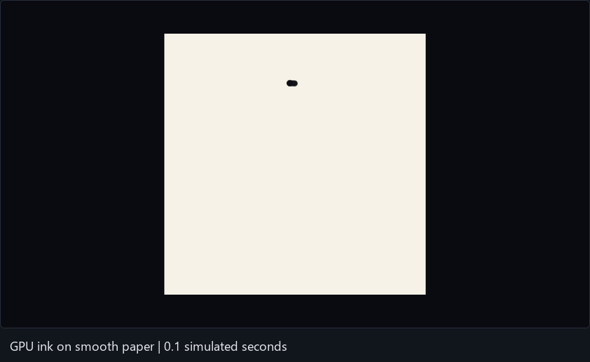
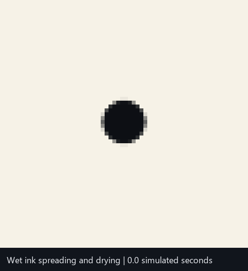
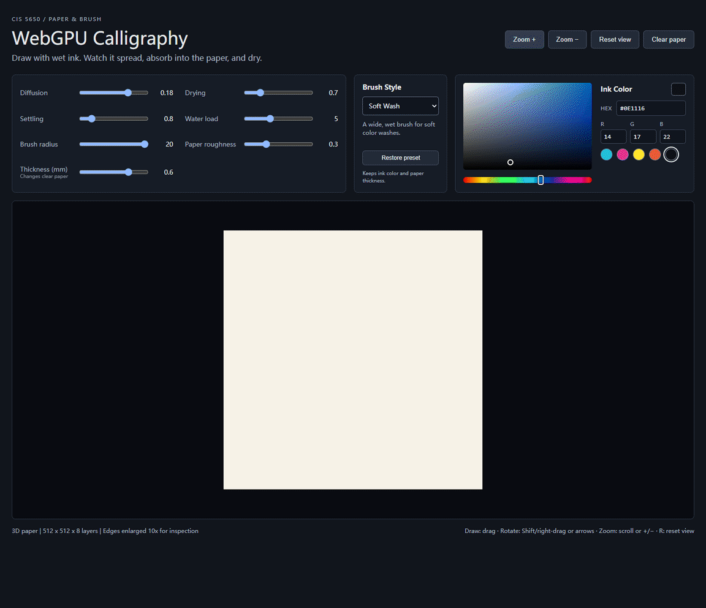

# CIS5650 Final Project — WebGPU Calligraphy

An interactive calligraphy tool for exploring how pens, brushes, ink, and paper affect a stroke. We plan to simulate ink deposition, spreading, absorption, and drying with WebGPU compute shaders, then compare a full-grid simulation with updates limited to wet tiles.

See the [project pitch](admin/WebGPU_Calligraphy_Pitch.md) for the proposed features, technical approach, existing work, milestones, and evaluation plan.

## Project layout

```text
admin/        Project pitch, milestone writeups, and course documents
src/          HTML entry point, TypeScript configuration, application code, and WGSL shaders
tests/        Simulation correctness tests, capture utilities, and stroke replay fixtures
performance/  Benchmark scripts, timing data, and analysis
media/        Screenshots, comparison images, and demo GIFs
```

This layout follows the source, test, image, and performance organization used in our earlier CIS 5650 projects.

The root keeps `package.json`, `pnpm-lock.yaml`, and `pnpm-workspace.yaml` together for dependency management. Application files live in `src`; benchmark JSON belongs in `performance`. Generated presentation builds and raw capture frames are ignored by Git.

## Run the first experiment

With Node.js 22.12+ (or a supported newer version) and pnpm installed:

```sh
pnpm install
pnpm dev
```

Open the localhost URL printed by Vite in a WebGPU-capable browser. WebGPU requires a secure context: localhost works for development; a remotely hosted copy needs HTTPS. The browser displaying the page must provide a WebGPU adapter.

```sh
pnpm build
```

The build command checks TypeScript and produces the production site in `dist/`.

## What this version does

WebGPU renders a smooth ivory sheet in perspective and simulates wet ink on a 1024 × 1024 grid. A fixed soft round brush deposits water and pigment directly on the GPU. Water spreads to neighboring cells, carries mobile pigment, and disappears through a combined absorption/evaporation term. Pigment settles permanently into the paper as the ink dries. Overlapping wet strokes mix their water and mobile pigment.

- Left-drag to draw; click for a round dot.
- Right-drag or Shift-drag to rotate; focused arrow keys also rotate.
- Scroll, use the zoom buttons, or press +/− while focused to zoom.
- Reset view (or R) restores rotation and zoom without erasing ink.
- Clear paper clears both simulation buffers; reload also clears the drawing.

The brush has a soft 24-texel diameter in paper space. Its screen size follows perspective and zoom. Input outside the paper is ignored; leaving the sheet breaks the stroke. Navigation is held fixed during drawing. Stroke segments use sample timestamps and swept-footprint normalization to reduce dependence on mouse event frequency. A starting dot receives one nominal 1/60-second dose; per-segment elapsed time is capped at 100 ms to prevent a stalled browser from depositing a large burst.

## Simulation

Two 48 MiB GPU storage buffers hold twelve floats per cell: water/mobile/settled pigment mass, mobile RGB absorption, settled RGB absorption, and alignment padding. Deposition touches the bounding rectangle of each segment. Neighbor-dependent transport reads one buffer and writes the other, then swaps them. Four-neighbor symmetric water flux uses a coefficient of 0.18 per step, bounding outgoing water to at most 72% of the available amount. Pigment follows the donor water concentration. Sheet edges have zero outward flux. Drying removes water and transfers pigment to the settled channel without deleting pigment.

The simulation uses a fixed 1/60-second timestep and up to six catch-up steps per animation frame. Hidden tabs pause; long stalls deliberately discard excess elapsed time. Rendering bilinearly interpolates optical mass and computes colored transmission in linear-light RGB, with a subtle wet-paper darkening. All cells are processed, including dry cells, to establish the full-grid baseline.

This is a simple local transport model with procedural paper fibers, not a full fluid solver. Separate material presets, pressure controls, rewetting of settled pigment, wet-tile optimization, export, and saved stroke replay remain later-milestone work.

## Validation and examples

```sh
# Terminal 1
pnpm dev --port 5174
# Terminal 2 (installed Google Chrome required)
pnpm test:gpu
# Optional GIF assembly: Python + Pillow required
python tests/make-gifs.py
```

Set `TEST_URL` to use another server URL. The browser suite launches headless Chrome with WebGPU, checks shader/GPU errors, conservation, drying, boundaries, sample-rate stability, and mouse/navigation controls. It records GPU timestamps when supported, frame intervals, screenshots, and deterministic capture frames. The test interface is exposed only when the URL contains `?test`. Raw frames are ignored by Git.

See [baseline measurements](performance/Milestone1_Baseline.md) and [raw results](performance/milestone1.json). GIFs show actual GPU-rendered output; timestamps indicate simulated time, and GIF playback is compressed during drying.





## Read the code in this order

1. `src/main.ts`: GPU initialization, drawing input, camera controls, rendering, and fixed timestep scheduling.
2. `src/ink-simulation.ts`: simulation buffers, compute pipelines, readback, and timing helpers.
3. `src/deposit.wgsl`: soft swept brush deposition of water and pigment.
4. `src/simulate.wgsl`: conservative neighbor transport, water loss, and pigment settling.
5. `src/paper.wgsl`: paper projection and simulation-state shading.
6. `src/paper-view.ts`: perspective ray picking into paper coordinates.

## Milestone 2: ink color and mixing

The color panel has a saturation/brightness field, hue strip, synchronized RGB (0–255) and six-digit hex inputs, and quick swatches. Arrow keys adjust the field; Shift makes larger steps. Changing color affects new deposits only. Reset sliders does not erase the selected color.

We use a **three-channel Beer–Lambert transparent-ink approximation**, not additive screen-color averaging or a full spectral paint model:

1. Decode the chosen sRGB color to linear light using the standard piecewise sRGB transfer function.
2. For each channel, compute an effective absorption coefficient `k = -ln(max(0.001, colorLinear))`.
3. Deposit optical mass `q = pigmentMass * k` alongside the existing pigment mass. Capture the color when each stroke segment is queued.
4. Transport `q` with exactly the same donor-cell water flux as mobile pigment. Settling transfers the same fraction of both into the fixed channels. Water removal does not delete optical mass.
5. Render `linearColor = paperLinear * exp(-2 * (qMobile + qSettled))`, then encode back to sRGB. The factor 2 calibrates 0.5 units of pigment to the selected transmission on white paper.

At any cell, `qTotal = sum(m_i * k_i)`: twice as much of one ink contributes twice as much absorption. Equivalently, its mixture coefficient is `sum(m_i*k_i)/sum(m_i)`. Equal cyan and yellow deposits make green; magenta and cyan make blue; yellow and magenta make red/orange. Additional layers darken the result. Overlap is order independent for identical deposited states; strokes made at different times can differ because the simulation moves and dries ink between them. Dry pigment stays fixed, but contributes optically under later strokes.

**Scope:** arbitrary RGB inputs do not determine real pigment spectra. This channel approximation is suitable for transparent dye-like inks; it does not reproduce every physical paint mixture (for example artist blue/yellow pigments), opaque white, scattering, chemical reactions, or rewetting. White contributes no absorption and behaves like a transparent wash. The 0.001 transmission floor avoids infinite coefficients for zero RGB channels. No measured pigment database or Kubelka–Munk solver is claimed.

### References

- [IUPAC Gold Book: Beer–Lambert law](https://goldbook.iupac.org/terms/view/B00626): exponential light attenuation with concentration and path length; basis of our optical model.
- [W3C CSS Color 4: color conversion code](https://www.w3.org/TR/css-color-4/#color-conversion-code): sRGB decoding/encoding equations. The color square uses the standard HSV parameterization solely for selection; mixing happens in optical-depth space.
- [Curtis et al., Computer-Generated Watercolor, SIGGRAPH 1997](https://grail.cs.washington.edu/wp-content/uploads/2015/08/curtis-1997-cgw.pdf): related pigment transport and optical compositing work. Their shallow-water and Kubelka–Munk models are context, not implementations copied or claimed here.

### Check and preview

With the development server on port 5180, run `node tests/validate-color.mjs`. It checks weighted mixtures, ordering, optical conservation, complete drying, clearing, input validation and responsive layout. Set `TEST_URL` for another port. `node tests/capture-color-mixing.mjs` records the actual GPU output; `python tests/make-color-mixing-gif.py` assembles the frames.


