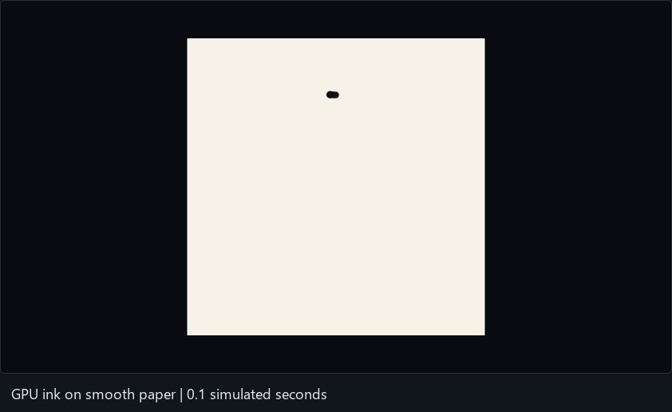
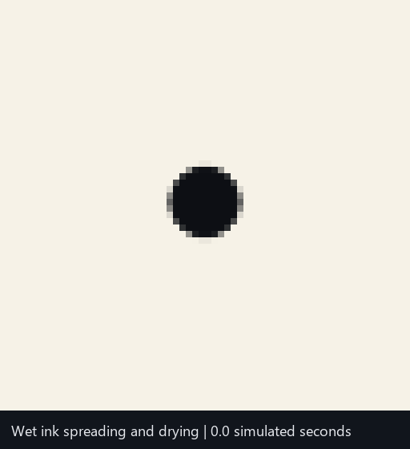

# CIS5650 Final Project — WebGPU Calligraphy

An interactive calligraphy tool for exploring how pens, brushes, ink, and paper affect a stroke. We plan to simulate ink deposition, spreading, absorption, and drying with WebGPU compute shaders, then compare a full-grid simulation with updates limited to wet tiles.

See the [project pitch](admin/WebGPU_Calligraphy_Pitch.md) for the proposed features, technical approach, existing work, milestones, and evaluation plan.

## Project layout

```text
admin/        Project pitch, milestone writeups, and course documents
src/          TypeScript application code and WGSL shaders
tests/       Simulation correctness tests and stroke replay fixtures
performance/  Benchmark scripts, timing data, and analysis
img/          Screenshots, comparison images, and demo GIFs
public/       Static assets served by the application
scripts/      Development and data-processing utilities
```

This layout follows the source, test, image, and performance organization used in our earlier CIS 5650 projects.

## Run the first experiment

With Node.js 22.12+ (or a supported newer version) and pnpm installed:

```sh
pnpm install
pnpm dev
```

Open the localhost URL printed by Vite in a WebGPU-capable browser. WebGPU requires a secure context: localhost works for development; a remotely hosted copy needs HTTPS. The browser displaying the page must provide a WebGPU adapter.

```sh
pnpm build
```

The build command checks TypeScript and produces the production site in `dist/`.

## What this version does

WebGPU renders a smooth ivory sheet in perspective and simulates wet ink on a 1024 × 1024 grid. A fixed soft round brush deposits water and pigment directly on the GPU. Water spreads to neighboring cells, carries mobile pigment, and disappears through a combined absorption/evaporation term. Pigment settles permanently into the paper as the ink dries. Overlapping wet strokes mix their water and mobile pigment.

- Left-drag to draw; click for a round dot.
- Right-drag or Shift-drag to rotate; focused arrow keys also rotate.
- Scroll, use the zoom buttons, or press +/− while focused to zoom.
- Reset view (or R) restores rotation and zoom without erasing ink.
- Clear paper clears both simulation buffers; reload also clears the drawing.

The brush has a soft 24-texel diameter in paper space. Its screen size follows perspective and zoom. Input outside the paper is ignored; leaving the sheet breaks the stroke. Navigation is held fixed during drawing. Stroke segments use sample timestamps and swept-footprint normalization to reduce dependence on mouse event frequency. A starting dot receives one nominal 1/60-second dose; per-segment elapsed time is capped at 100 ms to prevent a stalled browser from depositing a large burst.

## Simulation

Two 16 MiB GPU storage buffers hold four floats per cell: surface water, mobile pigment, settled pigment, and padding. Deposition touches the bounding rectangle of each segment. Neighbor-dependent transport reads one buffer and writes the other, then swaps them. Four-neighbor symmetric water flux uses a coefficient of 0.18 per step, bounding outgoing water to at most 72% of the available amount. Pigment follows the donor water concentration. Sheet edges have zero outward flux. Drying removes water and transfers pigment to the settled channel without deleting pigment.

The simulation uses a fixed 1/60-second timestep and up to six catch-up steps per animation frame. Hidden tabs pause; long stalls deliberately discard excess elapsed time. Rendering bilinearly interpolates the state and converts total pigment to darkness, with a subtle wet-paper darkening. All cells are processed, including dry cells, to establish the full-grid baseline.

This is a simple local transport model with uniform paper, not a full fluid solver. Separate material presets, pressure controls, rewetting of settled pigment, wet-tile optimization, export, and saved stroke replay remain later-milestone work.

## Validation and examples

```sh
# Terminal 1
pnpm dev --port 5174
# Terminal 2 (installed Google Chrome required)
pnpm test:gpu
# Optional GIF assembly: Python + Pillow required
python tests/make-gifs.py
```

Set `TEST_URL` to use another server URL. The browser suite launches headless Chrome with WebGPU, checks shader/GPU errors, conservation, drying, boundaries, sample-rate stability, and mouse/navigation controls. It records GPU timestamps when supported, frame intervals, screenshots, and deterministic capture frames. The test interface is exposed only when the URL contains `?test`. Raw frames are ignored by Git.

See [baseline measurements](performance/Milestone1_Baseline.md) and [raw results](performance/milestone1.json). GIFs show actual GPU-rendered output; timestamps indicate simulated time, and GIF playback is compressed during drying.





## Read the code in this order

1. `src/main.ts`: GPU initialization, drawing input, camera controls, rendering, and fixed timestep scheduling.
2. `src/ink-simulation.ts`: simulation buffers, compute pipelines, readback, and timing helpers.
3. `src/deposit.wgsl`: soft swept brush deposition of water and pigment.
4. `src/simulate.wgsl`: conservative neighbor transport, water loss, and pigment settling.
5. `src/paper.wgsl`: paper projection and simulation-state shading.
6. `src/paper-view.ts`: perspective ray picking into paper coordinates.
